# Chat v7: behavior and implementation review

This change makes finished answers easier to read and keeps writing, questions and queued work under their owning conversation. The work includes shared transcript logic, queue dispatch recovery and API error handling alongside the clay UI changes.

PR target: `dev`. Comparison base: `origin/dev` at `707af32d`. Source branch: `t3/chat-ui-review`. The reviewed production UI index has SHA-256 `40632ebe88d7229dc322961cae1fdac6b7840a6455600f46e8a5ef99d992133d`. Subsequent edits repair documentation encoding and contradictory descriptions; product UI source is unchanged from the scored build.

## Renderer comparisons

The six pairs below use a clean `origin/dev` renderer at `707af32d` and the reviewed v7 renderer, connected to the **same current benign saved QA API through a read-only proxy**. They compare UI rendering of shared current state. The baseline backend and an original historical database are not recreated. Ordering, retry, request persistence and API contracts are established by tests and runtime evidence described below, rather than by these images.

### Finished answer

| Before: `dev` renderer                                                             | After: v7 renderer                                                               |
| ---------------------------------------------------------------------------------- | -------------------------------------------------------------------------------- |
| 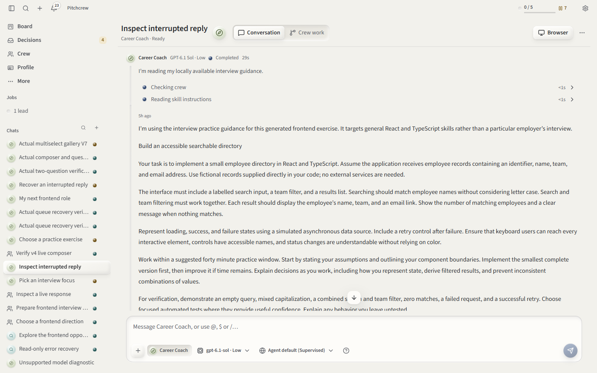 | 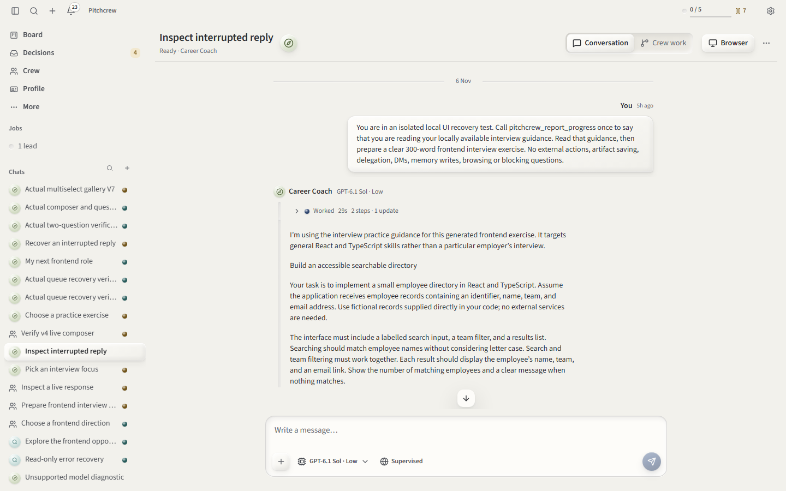 |

Answer hierarchy, folded turn activity, bounded prose and quiet copy/timestamp controls. UI renderer comparison against the same current saved state.

### Pending question

| Before: `dev` renderer                                                                | After: v7 renderer                                                                  |
| ------------------------------------------------------------------------------------- | ----------------------------------------------------------------------------------- |
| 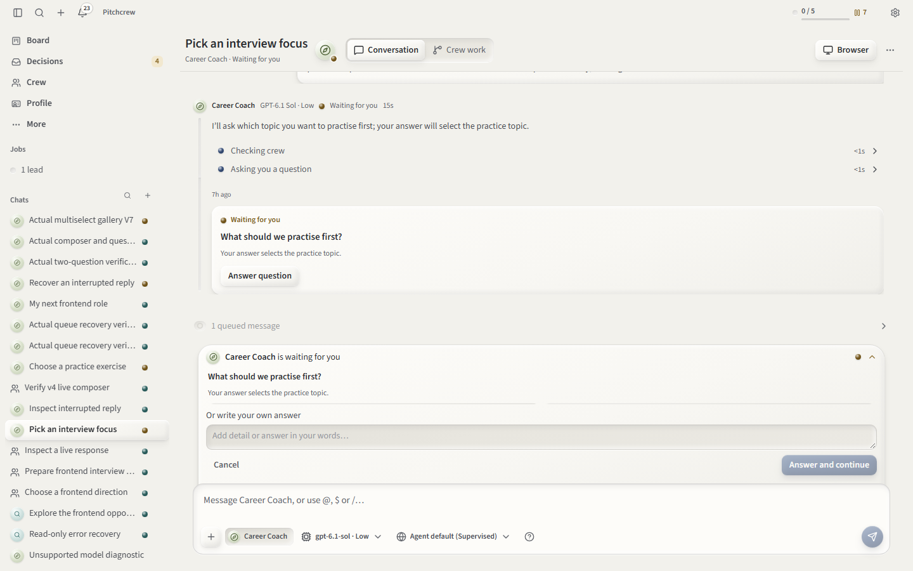 | 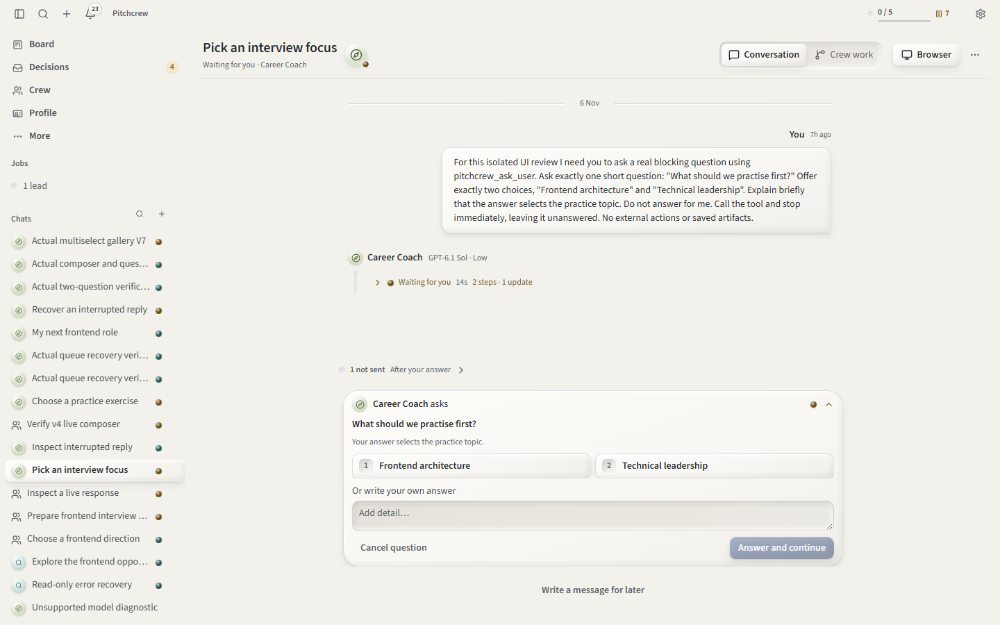 |

One question dock, readable choices and answer controls. The images show layout; answer retention, submission locks and focus ownership have separate interaction coverage.

### Mobile job conversation

| Before: `dev` renderer                                                                 | After: v7 renderer                                                                   |
| -------------------------------------------------------------------------------------- | ------------------------------------------------------------------------------------ |
| 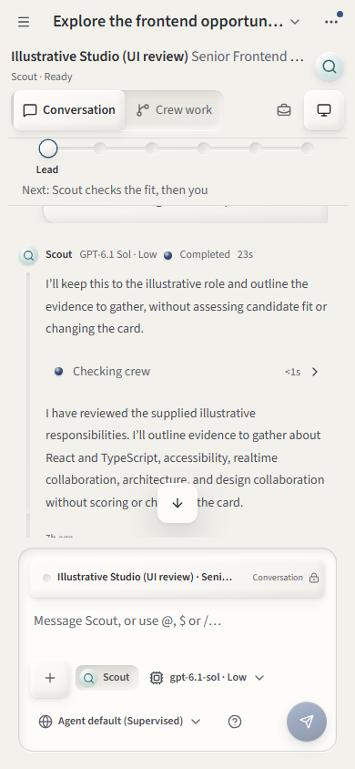 | 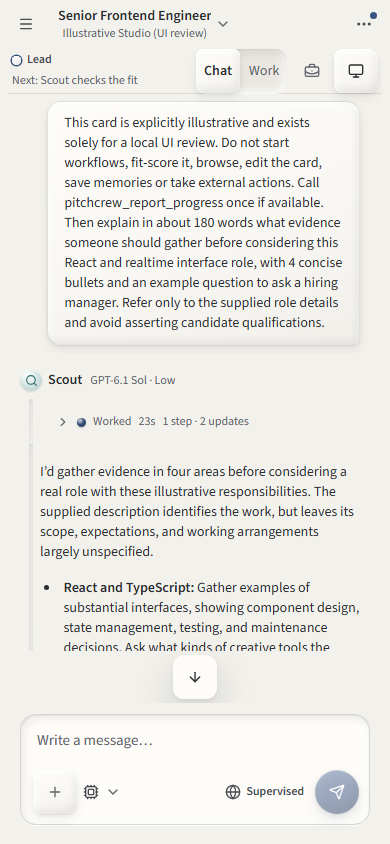 |

Job title/company, lower Chat/Work tabs, compact stage/next action and composer controls. UI renderer comparison against the same current saved state.

### Mobile group conversation

| Before: `dev` renderer                                                                     | After: v7 renderer                                                                       |
| ------------------------------------------------------------------------------------------ | ---------------------------------------------------------------------------------------- |
| 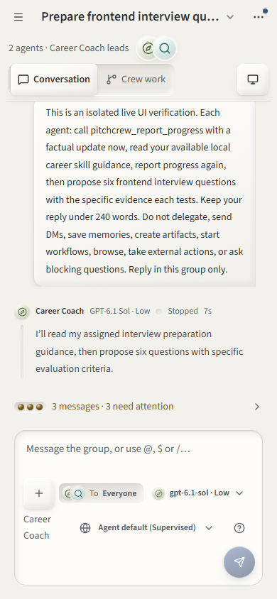 | 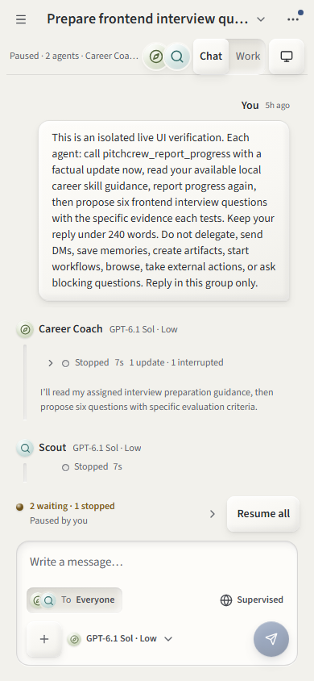 |

Group identity, routing, reading hierarchy and compact controls. Shared current API state supplies both renderers; images do not prove dispatch behavior.

### Genuine multi-select question

| Before: `dev` renderer                                                                       | After: v7 renderer                                                                         |
| -------------------------------------------------------------------------------------------- | ------------------------------------------------------------------------------------------ |
| 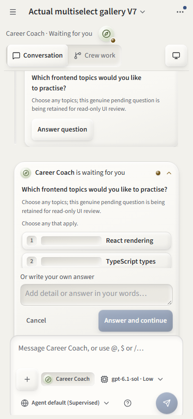 | 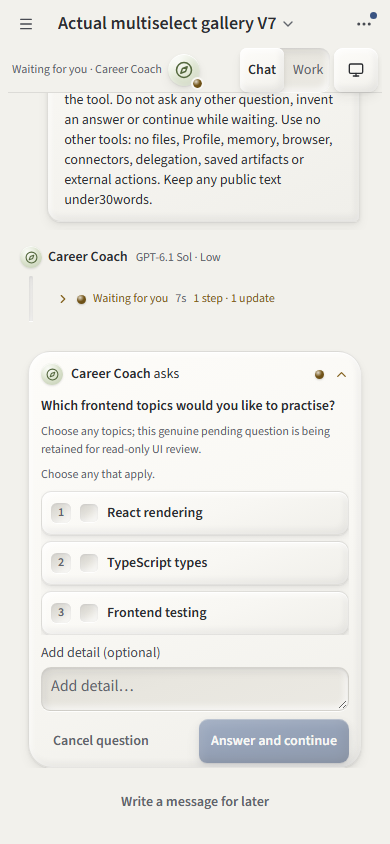 |

Intrinsic shared-checkbox sizing, full option labels and bounded question reading. Both renderers read the same actual saved question; no answer is submitted to create the comparison.

### Short job sheet

| Before: `dev` renderer                                                              | After: v7 renderer                                                                |
| ----------------------------------------------------------------------------------- | --------------------------------------------------------------------------------- |
| 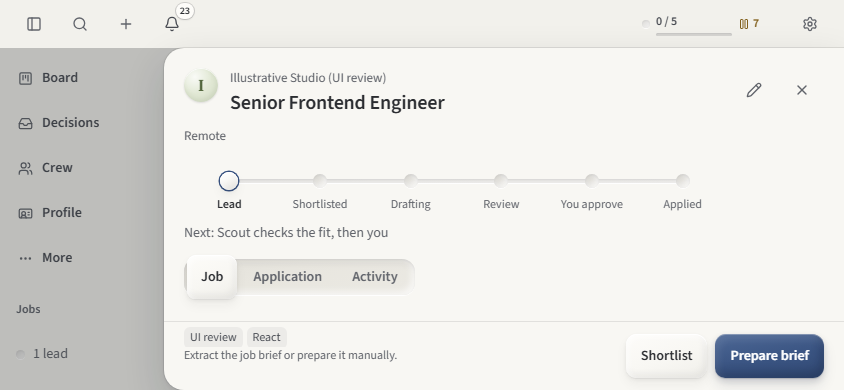 | 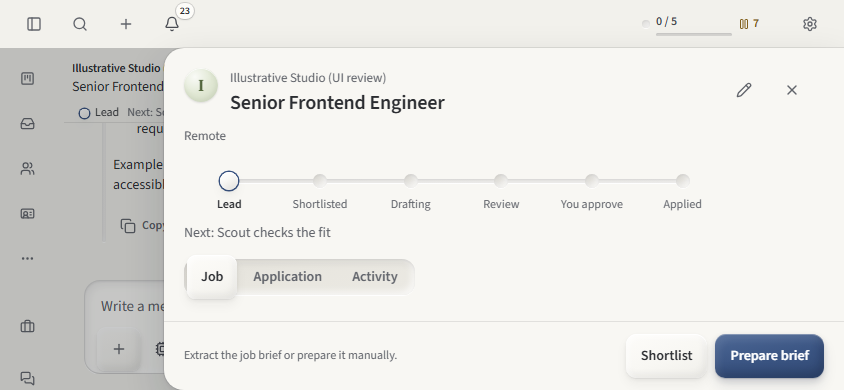 |

Identity, progress and section controls scroll with the content while the action footer remains pinned. UI renderer comparison against the same current saved state.

## All change groups

### 1. Shared transcript ordering, visibility and page boundaries

Saved history and live rendering previously calculated order independently. Group runs finishing out of order could separate a turn's activity from its own answer; automatic mention forwards and queued inputs could also repeat in the transcript.

New core helpers give both paths the same presentation rules. Settled activity sits immediately before that role's final reply, while active and waiting work stays chronological. Failed or cancelled turns remain visible even when the runtime emitted no activity. An exact redundant `Run cancelled.` system note can fold into the represented cancelled turn. These are presentation rules: saved messages, task delivery and search history remain intact.

Forward folding requires matching run, thread, task recipient, text, sender, reference metadata and ordering. Attachments, notifications, questions, distinct instructions and intentional repeats remain visible. Never-started queued, paused or failed inputs stay in Queue. A displayed cancelled-before-start input says `Not sent · cancelled`.

A user message enters presentation order at its first actual delivery, derived from saved request/run relationships. Original written timestamps remain stored; time tooltips distinguish written and sent times. Retrying a request does not move that first delivery when current attempt pointers change. Silent completed runs still establish dispatch without adding an empty activity row.

The board builds lightweight thread projections for messages, tasks and requests in three reads, then hydrates only the selected page. Shared windows target 50 entries and allow one extra context row to keep a settled turn/answer pair together. Older/Newer/Latest anchors and live merges preserve these boundaries, server dispatch positions and saved activity omitted from compact run metadata.

Files: `packages/core/src/transcript-order.ts`, `transcript-visibility.ts` and exports; `packages/board/src/board/conversation-history.ts`, `transcript-messages.ts`; `packages/ui/src/ChatTurn/helpers.ts`, `transcript-messages.ts`; `ChatView/history.ts`, `remote-history.ts`, `hooks/useConversationHistory.ts`.

### 2. Turn activity, outcomes, failures and work duration

Expanded operational commentary previously competed with finished answers, and displayed duration included time spent waiting for the user. Each turn now has an initially collapsed outcome disclosure with step/update and failure/interruption counts. Running previews show bounded recent commentary and current work; settled previews preserve the latest failed/interrupted step. The full ordered log and its existing truncation notice remain available.

Identity/model headings, outcome beads and elapsed work share a quieter hierarchy. An answered waiting turn says `Answer saved` while its continuation proceeds. Durations subtract saved human-answer waits and idle gaps before or between continuation attempts, including descendant questions. Intervals are clamped/merged and traversal guards cycles; accessible descriptions distinguish answer waiting from continuation waiting. Browser activity and job-agent previews use the same calculation.

Saved failures get a plain explanation, `Write a follow-up` and original copyable diagnostics without becoming a new alert on navigation. Read-only histories retain their restrictions. Finished ordinary replies gain Copy and a timestamp footer; fine pointers reveal it on hover/focus and touch keeps it visible. Questions and streaming answers exclude Copy.

The two adapter edits only change startup commentary to `Agent started. Preparing a reply…`; process launch, timeout and adapter retry algorithms are unchanged.

Files: `ChatTurn/activity-summary.ts`, `timing.ts`, `index.tsx` and activity/failure/duration components; `ChatView/components/TranscriptMessage.tsx`, `ReplyActions.tsx`, `MessageTimestamp.tsx`; browser/job-agent duration call sites; `packages/adapters/src/acp.ts`, `process/launch.ts`.

### 3. Main drafts and asynchronous send ownership

Component-local text, references and files could disappear on page navigation, and a completed send could clear newer writing. A renderer-scoped store now owns each conversation's exact text, atomic reference metadata, `File` objects, in-flight operation and kept drafts across route unmounts and browser/chat editors.

Send snapshots the complete old payload before attachment encoding or HTTP and opens a fresh editable draft. Per-thread operation tokens prevent duplicate sends and stale completions consuming newer work. Typing, context and file edits remain available during unrelated work or the thread's pending send; mutation/configuration controls retain their own gates.

Only acknowledged requests consume the submitted snapshot. An accepted write followed by failed refresh shows a retained acknowledgement and a read-only refresh action. Unknown outcomes keep the old payload separately, with review and diagnostics; no automatic resend or guessed receipt is introduced. Local encoding failure restores a pristine replacement or preserves both drafts if writing continued. Delegation keeps files in the editable draft because its endpoint sends text and role IDs.

Prefills, starters, Tracker handoffs and session handoffs preserve a displaced payload. Kept-draft review swaps whole text/reference/file payloads; explicit discard removes only the chosen snapshot. Dialog identity and owned focus belong to the originating conversation. Lexical layout-time synchronization keeps rendered text and reference metadata current through route transitions.

This state survives ordinary navigation in the running renderer. A reload, browser close or process restart loses in-memory drafts.

Files: `ChatView/composer-state.ts`, `composer-send.ts`, `composer-recovery.ts`; composer draft/attachment/view hooks and recovery/dialog components; `ChatComposer/helpers.ts`, `hooks/useEditorSync.ts`; `AgentBrowser/components/BrowserReply.tsx`.

### 4. HTTP errors and accepted writes

A failed mutation and an acknowledged mutation whose following GET failed previously looked alike. `ApiHttpError` retains HTTP status and a validated server reason, including error responses with invalid JSON, while network/abort/success-body parsing errors keep their identities. HTTP status alone makes no claim about commit persistence or safe retry.

`ActionRefreshError` wraps only a successful mutation followed by failed reload and carries the accepted result. A genuine mutation failure stays original and does not trigger a reload. Recovery-owning callers can suppress a duplicate shared toast. Error tests retain the existing metrics/analytics contract and keep server reason text out of diagnostic properties.

Main sends and queued edits share strict reference projection: identity, trim-relative offsets and skill revision are submitted; display-only labels are removed. There are no new API routes, event/database schema versions, dependency changes or package-version changes.

Files: `packages/ui/src/api.ts`, `api-errors.ts`, `WorkspaceStore/actions.ts`, `action-errors.ts`, `types.ts`; `ChatComposer/helpers.ts` and send/edit callers.

### 5. Question state, dock and focus

The open question now owns one answer dock; its matching transcript record folds while open and offers `Answer question` when collapsed. Question previews identify collapsed rows. Collapse records known question IDs, so a later arrival opens normally. `Write a message for later` reveals the preserved main composer.

Text, selected IDs and in-flight response state are retained by exact question across chat and Decisions navigation. Only authoritative resolved status prunes a draft; absence from a partial snapshot does not. Different unsent responses resolved elsewhere become copy/discard recovery trays. Owned focus moves neutrally to that retained response instead of redirecting continued typing into a new message.

An empty idle main composer can hide while the answer dock owns input, but remains mounted/inert. Existing text, files, references, kept drafts, pending sends and recovery notices keep it available. A latch protects the active editor when its last text/file/reference is removed. Arrival focus targets free-answer entry; response completion respects ownership and route changes. Choice completion uses a neutral non-text target.

Single-choice confirmation retains its short delay, accepts a corrected digit, ignores key repeats/composition/unrelated controls and cancels a stale choice when custom text is entered. Multi-select detail remains additive. Native fieldsets, labels, error/status descriptions, readonly/busy state and intrinsic shared checkboxes preserve usable control semantics. Choice content scrolls within a bounded region; growing free answers and actions sit outside it. Reveal follows opening/growth while releasing control to deliberate reading.

Files: `UserQuestions/question-state.ts`, `reconcile-response.ts`, `focus.ts`, `QuestionDockProvider.tsx`; response/selection/lifecycle/composer/reveal/focus hooks and question/feedback/options/recovery components; `ChatView/components/ConversationInput.tsx`.

### 6. Question submission recovery, Decisions and notifications

Responses have one question-specific lock. An acknowledged write with failed refresh or an ambiguous outcome offers a GET-only status check before another submission. A server rejection reason remains visible. Only a successful read confirming pending allows retry, and an unchanged rejected payload stays blocked until corrected; failed status reads remain uncertain. Unrelated work does not lock answer typing.

Decisions shares the answer/recovery model, associates its external Cancel control with the actual form and moves owned resolution focus to the next heading, retained response or empty state. `Cancel question` wording makes the action explicit.

Only the exact visibly open question toast is suppressed or closed on its matching visible route. Modal/inert, visibility and route changes release ownership without changing bell/read/pending data. One conversation announcer starts empty on navigation and reports coarse running/question phases or newly observed failures/stops. Historical and token/commentary updates remain quiet; the transcript log disables its implicit live announcements. Global shortcuts treat forms/input scopes as typing contexts, and digits belong only to body/current-question controls.

Files: `UserQuestions/hooks/useQuestionResponse.ts`, toast ownership helpers/hooks; `Decisions` sheet/recovery/focus components; `Notifications/helpers.ts`, `hooks/useNotifications.ts`; `ChatView/announcement.ts`, announcer/history components; `shortcuts.ts`.

### 7. Queue reading, editing and recovery presentation

Queue summaries distinguish wholly unstarted inputs from partially delivered group messages and explain user pauses, stopped work, failures and answer holds. Collapse persists per conversation/device and reopens for new attention rather than mere row reorder/removal. Bounded keyboard-scrollable previews expose overflow cues; rows expand original multiline text and saved attachment metadata. Height-transition reveal stays within the queue and yields to user scrolling.

A separate multiline Lexical editor preserves newlines, atomic references, skill revision, trimmed offsets and saved attachments. Its unsaved state survives a row starting delivery; Save then explains why correction is needed. Existing unsaved-change guards protect close/navigation. Queue editing neither modifies the normal composer nor sends a message.

Edit and options replace repeated action icons. Menus expose existing reorder/remove/interrupt/resume commands with correct bounds and labels, including `Cancel remaining replies`. Mixed recipient states retain individual beads and explanations; exact terminal-stripped errors live under copyable Details.

Recovery identifies the actual head: Resume all/queue applies to eligible user pauses; Retry targets unfinished attempted work. Other blocking chats link to their actual conversation, while failed crew tasks or unavailable conversations link to Queue. A new attached chat can explain its shared job hold without presenting another chat's messages as local. Recovery preserves owned focus, and router links retain unsaved guards. Composer labels explain answer/resume/retry holds, including compact phone wording.

Files: `ChatView/queue-presentation.ts`, `queue-recovery.ts`, `queue-recovery-plan.ts`, `queue-row-state.ts`, `queue-focus.ts`, `queue-scroll.ts`; queue, row/editor, diagnostics, attachments and shared-context components; disclosure/scroll/editor-selection hooks; composer status/send controls.

### 8. Backend queue recovery contract

Request-level resume now rejects a non-head before changing state and blocks failed crew follow-ups. A transaction requeues only accessible unfinished recipients of that head, clears stale attempt/error fields, preserves completed recipients, resumes later never-started paused messages and unpauses the queue. Normal admission still controls dispatch.

When a head finishes with only failed/interrupted/paused unfinished deliveries, the queue pauses explicitly. A separate later failed attempt requires its own review rather than becoming an implicit bulk retry. Paused Make next rejects with resume/send-now guidance. Global Resume rejects failed requests even if the saved pause kind is user, alongside existing task/interruption gates. Explicit interrupt/send-now keeps its existing reorder meaning.

Contract tests assert rejected non-head mutation, completed-recipient preservation, continuation of later never-started work and a second explicit retry at another attempted failure. These semantics are a material backend change and are independent of the adapters' commentary edit.

Files: `packages/orchestrator/src/crew/conversation-queue.ts`, `queue/commands.ts`, new `queue/recovery.ts` and corresponding contract tests.

### 9. Markdown, tables, references and reading width

Referenced/cited messages retain default GFM support for tables, tasks and strikethrough. Custom native lists use outside markers, hanging wrapped/nested paragraphs and gutters for multi-digit numbering. Saved task state uses one disabled shared checkbox. Prose is bounded to 76ch; tables and code use the available lane.

Tables have a labelled horizontal viewport, keyboard scrolling, overflow guidance and one quiet Copy as Markdown action with streaming disable/success/fallback feedback. Inline references keep text-height visuals while gaining larger pointer areas and visible focus. Mention/file/draft popovers have 12px padding; available agent mentions open existing Agent settings. New devices default to Comfortable width while saved width choices remain unchanged.

Files: `ChatReferences/components/ReferenceMessage.tsx`, `ReferenceChip.tsx`, Markdown list/task/table/copy components; `ChatView/preferences.ts`; reading/reference/transcript styles.

### 10. Responsive clay surfaces and browser/runtime polish

The sticky chat header uses stable grid placement. Phone title/company gets the top-bar lane; labelled Chat/Work tabs sit below. Compact stage/next-action context replaces the full track on phones and short windows. Composer layout measures its actual lane: routing/model/context and dispatch retain stable positions, narrow browser preparation uses a labelled popover with effective Supervised/Autonomous mode, and duplicate locked job context disappears. Tooltips carry keyboard guidance. Controls retain visible focus and 32px desktop/44px phone/coarse targets.

Short windows preserve readable history, bound queue/answer regions and allow whole-column scrolling. Active composer growth reveals Send without moving its pressed target or overriding deliberate wheel/touch reading. Scroll to latest has its own strip. Short coarse chats temporarily start the sidebar as a rail; temporary toggles preserve the ordinary saved preference and restore it on exit.

Short job sheets scroll identity, progress and section controls with content while retaining the footer. Typography, quiet day grooves, dark rails/empty beads, participant overlap and spinner treatment follow clay rules. Browser empty surfaces own one Open action; closed streamed sessions omit the redundant toolbar. Expanded browser replies use the shared draft/recovery path. Model/default labels use loaded catalog names; repetitive helper copy and unknown-sign-in chat banners are reduced while actionable readiness notices remain.

Files: design-system sidebar provider/state/types; `App/Workspace` and short-coarse hook; chat heading/composer/ClayInterface components; job-detail/loading wrappers; browser controls/mode/reply/activity/streamed components; `ModelField`, runtime-readiness notice; changed chat, responsive and job-detail CSS.

### 11. Tests, configuration and maintained documentation

Pure tests cover shared transcript order/visibility/windows and first dispatch, board bounded hydration/search/paging, activity/timing, draft operations, strict reference payloads, queue plans/recovery, question selection/state/shortcuts, notification visibility, sidebar attention and announcements.

Mounted browser/component coverage exercises actual Lexical references and `File` identity through SPA trips, pending send ownership, kept-draft dialogs, question focus/latch/choice corrections, external resolution, compiled CSS checkbox size, bounded scrolling and router guards. Bounded temporary HTTP daemons exercise real rejection/status/accepted-refresh edges without providers. Root Vitest adds the UI `@` alias for mounted imports.

The full-app question-layout regression checks settled Motion clipping, hidden composer, retained answers and action reachability through the actual scroll owner. Its short-layout minimum is four body lines (80px); scroll-into-view coverage establishes reachability, not immediate Send visibility while reading an expanded queue. Separate final wheel probes cover that narrower scrolling claim.

`AGENTS.md` and `docs/chat-redesign.md` document the new contracts. Existing punctuation encoding churn and contradictory descriptions are repaired. This PR has no release version bump or dependency change.

## Validation and evidence boundaries

- Final targeted run: **225/225 passed across 36 files**, with no failures/skips. Overlapping focused suites are included in that count, not added again.
- Typecheck plus landing checks, full lint (**1,057 component checks**), production UI build and `git diff --check` pass in the recorded evidence.
- Final layout evidence contains **49 captures across six viewport configurations**, with no page errors/horizontal overflow or failed matrix assertions. A separate wheel probe verifies recoverable access when expanded queue reading puts Send below the viewport; it does not claim Send is always immediately visible.
- **24 final light/dark desktop/320px axe scans** report zero violations. Material-gradient color contrast remains incomplete; DOM/axe/focus checks are not spoken screen-reader certification.
- An earlier full-app question-layout run passed before the final small semantic/dialog/recovery edits. The final UI was rebuilt afterward. That earlier pass is separate from the final targeted count and is not represented as a run against the final hash.
- The root test wrapper has an existing Windows PostHog malformed-path failure before Vitest. **There is no full-repository-suite pass claim.**
- Actual installed **Codex** ran in an isolated production workspace with **Demo unavailable**. The final sequence completed four actual runs, including two deliberate question answers, delayed old/new send ownership, corrected digit selection and a separately saved genuine pending multi-select question. Controlled fixtures remain separately labelled; earlier Stop/Resume/queue-edit evidence is not relabelled v7.
- Independent final reviews on the frozen UI: **Claude A 9.1/10, Claude B 9.2/10, Codex 9.3/10**. All report no blockers. The scores apply to reviewed source/browser surfaces, not every platform or scenario.

## Known follow-ups

Reviewers retain these non-blocking findings: phone-landscape question titles can be obscured by the sticky header; a local composer error can cross conversation boundaries; user-owned Cancel can discard a typed answer; Decisions free-answer entry can fall below an unclear fold; main-send details require opening recovery review; composer recovery notices lack a dedicated async status announcement; compact phone/group controls remain dense.

Draft retention is renderer-local and does not survive reload/process restart. Native Electron paint, Escape ordering, approval viewport/presentation and related guest flows remain unverified: native launch was rejected by automatic approval policy and was not bypassed. Spoken screen readers, physical touch and RTL remain unverified. These limits and findings remain separate from the above no-blocker review verdicts.

## Screenshot provenance and fresh-checkout validation

The image [provenance record](./chat-v7/images/provenance.json) includes both renderer hashes, source baseline, original PNG dimensions and SHA-256 digests. All twelve captures were inspected for personal data. They contain neutral UI QA conversations and an illustrative employer, not a real application. No images were generated or altered. Inline activity and folded activity naturally expose different parts of long replies; the short-sheet pair shows the initial loaded position.

PR preparation in a fresh checkout separately passes the same 225 targeted tests, lint, typecheck/landing and the complete browser/Electron bundle build. The fresh checkout emits index hash `25e47fd25e2d596a18d87b596b2508547fae5bdb456fa15ebee820ced939e522`; generated JavaScript/chunk hashes differ from the reviewed build, while all reviewed product-source bytes and CSS assets match. The screenshots and design scores are explicitly bound to the original reviewed `40632` artifact, not falsely relabelled as the fresh build. Documentation encoding/formatting repairs, this review document and images are the only additional repository content.
