# State machines

Generated from `packages/core/src/lifecycles.ts` by `bun run docs:state-machines`. Do not edit by hand.

Each diagram is the complete list of moves a status may make. Saving an entity without
changing its status is always allowed. Tests refuse any other move
(`PITCHCREW_LIFECYCLES=enforce`); an installed daemon saves it and warns once, so a move
the tables missed never stops work. To add a move, change the table, run the generator and
cover the new edge with a test.

## Job

Checked by `board.move`. Crew work saves jobs through `board.crewMove`, which also allows these rework moves (`reworkTransitions`):

- changes_requested → in_review
- agreed → in_review
- awaiting_approval → in_review
- in_review → drafting

User and `manageWorkflow` corrections may record any status.

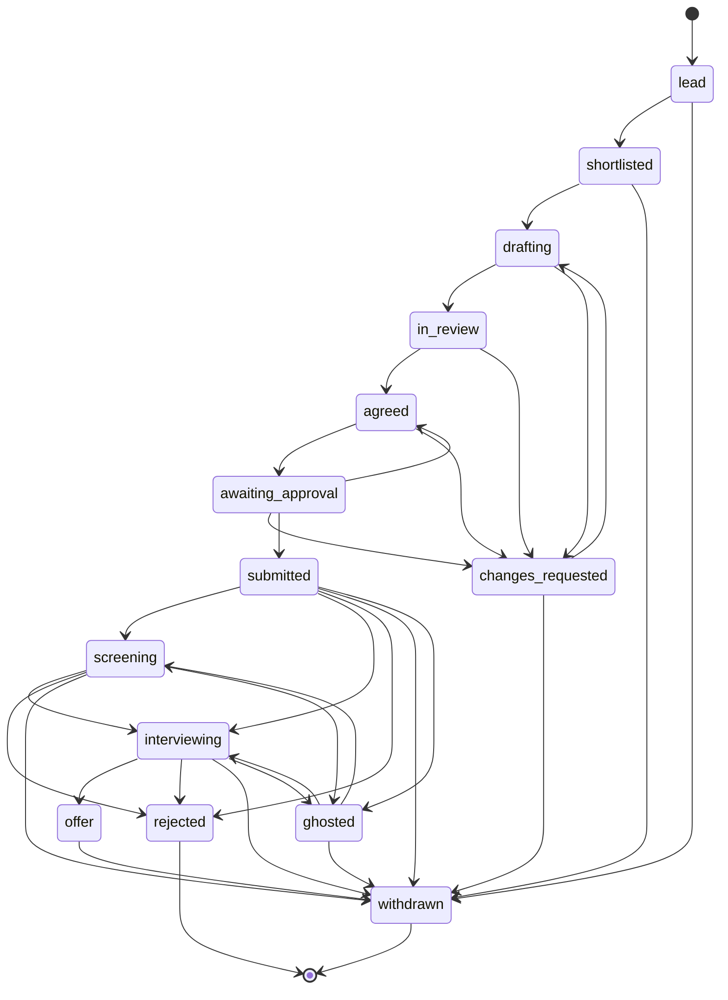

Named sets:

- `preparing`: lead, shortlisted, drafting, in_review, changes_requested, agreed, awaiting_approval
- `applied`: submitted, screening, interviewing, offer
- `closed`: rejected, withdrawn, ghosted
- `draftable`: shortlisted, changes_requested
- `reviewable`: in_review, agreed, awaiting_approval

## Run

Checked on every board write.

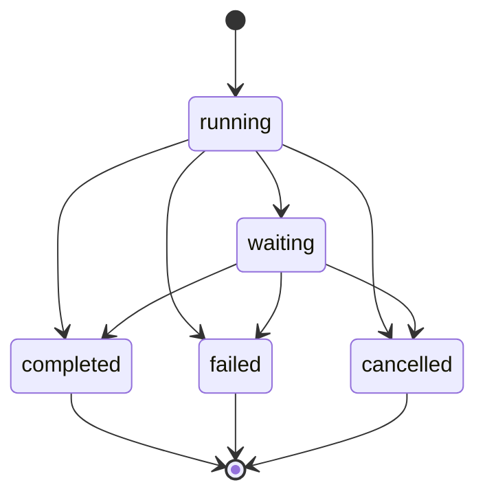

Named sets:

- `live`: running, waiting
- `settled`: completed, failed, cancelled

## Crew task

Checked on every board write.

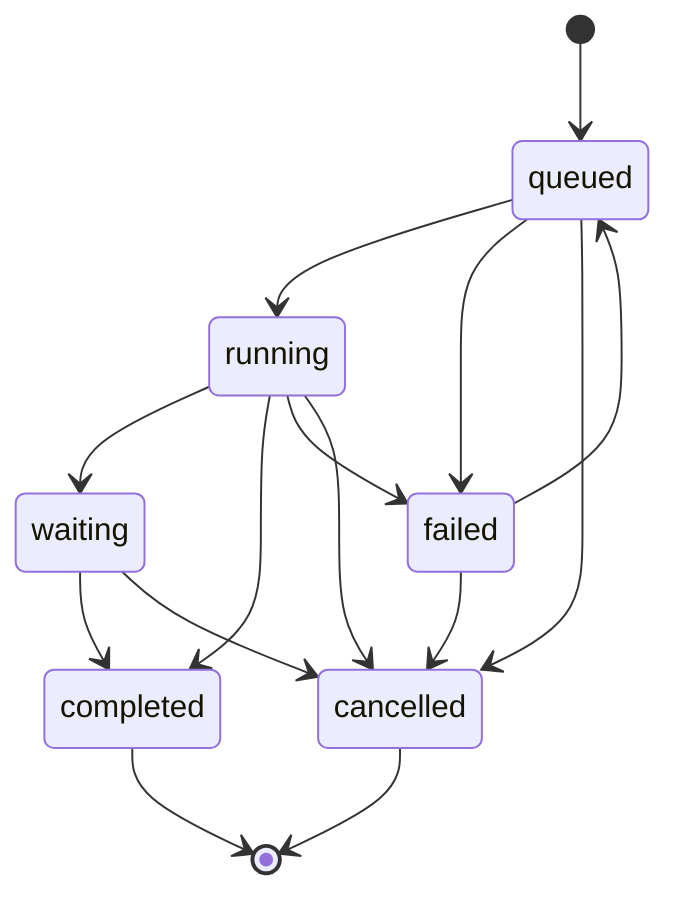

Named sets:

- `live`: queued, running, waiting
- `engaged`: running, waiting
- `recoverable`: queued, running
- `settled`: completed, failed, cancelled

## Message delivery

Checked on every `chat_request` write, per recipient.

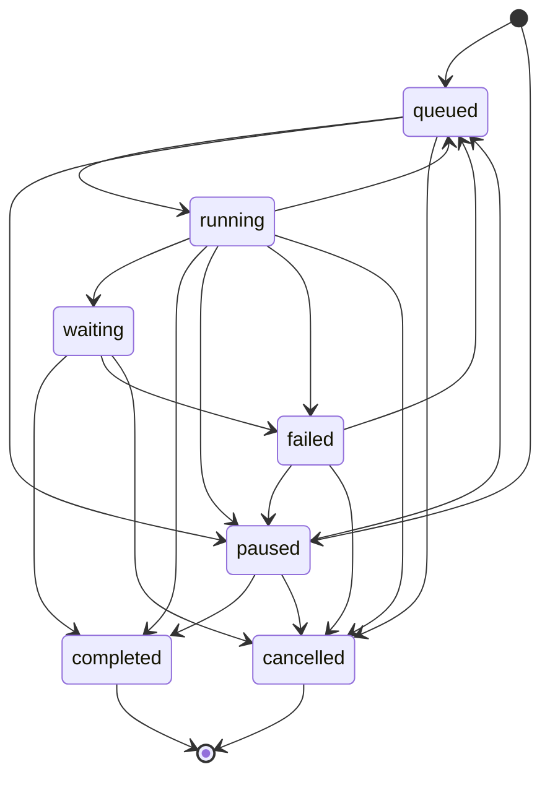

Named sets:

- `done`: completed, cancelled
- `unsent`: queued, paused, failed
- `stopped`: paused, failed
- `engaged`: running, waiting
- `moving`: queued, running
- `active`: queued, running, waiting

## Question

Checked on every board write.

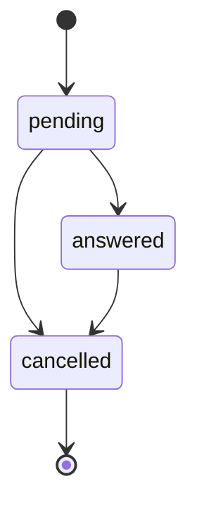

## Packet approval

Checked on every board write.

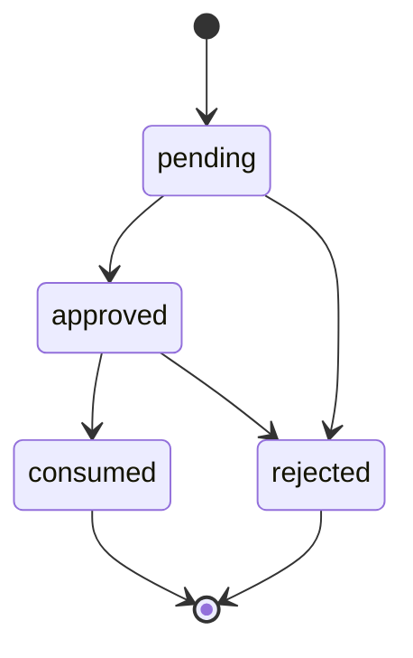

Named sets:

- `open`: pending, approved
- `granted`: approved, consumed

## Browser action approval

Checked on every board write.

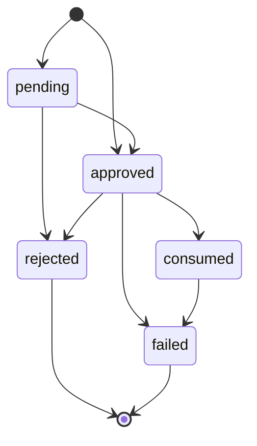

Named sets:

- `open`: pending, approved
- `used`: consumed, failed

## Submission attempt

Checked on every board write.

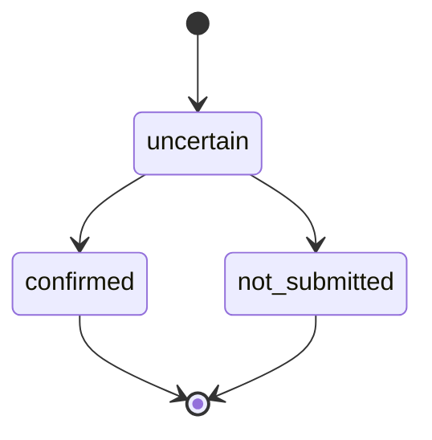

## Deep review

Checked on every board write.

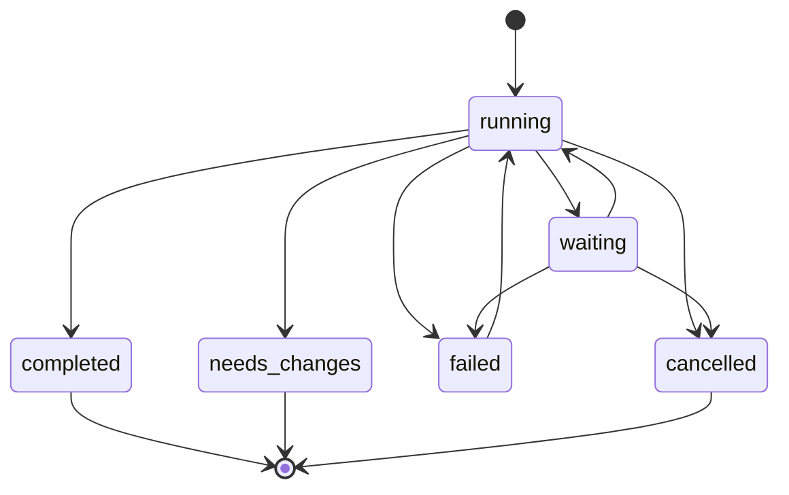

Named sets:

- `live`: running, waiting
- `resumable`: waiting, failed

## Review subagent

Checked on every board write.

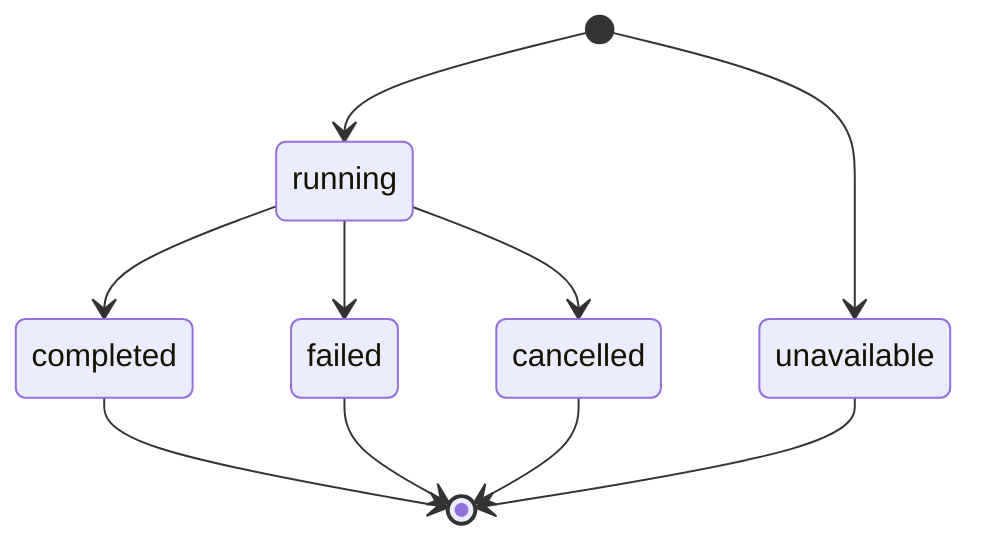

## Delegation round

Checked on every board write.

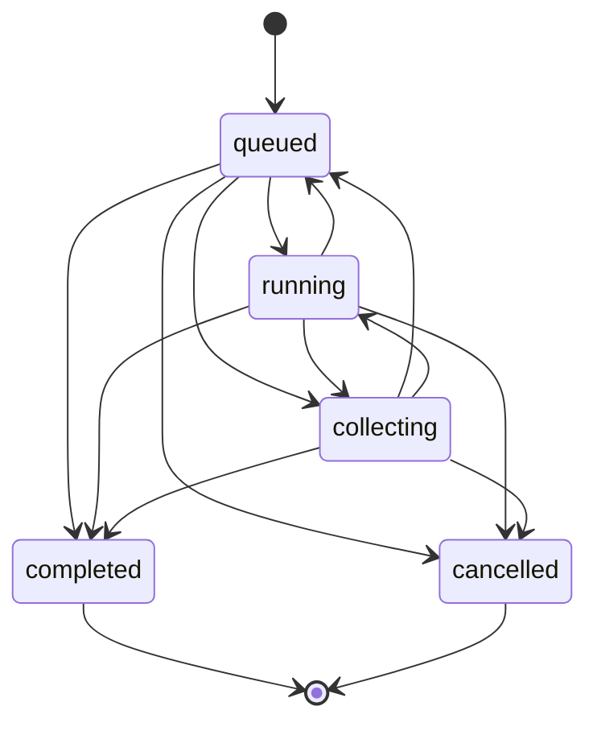

Named sets:

- `settled`: completed, cancelled

## Proposal

Checked on every board write.

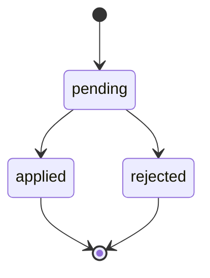

## Profile update

Checked on every board write.

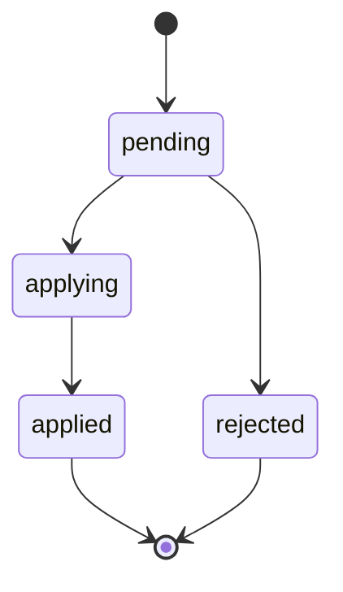

Named sets:

- `open`: pending, applying

## Tracking signal

Checked on every board write.

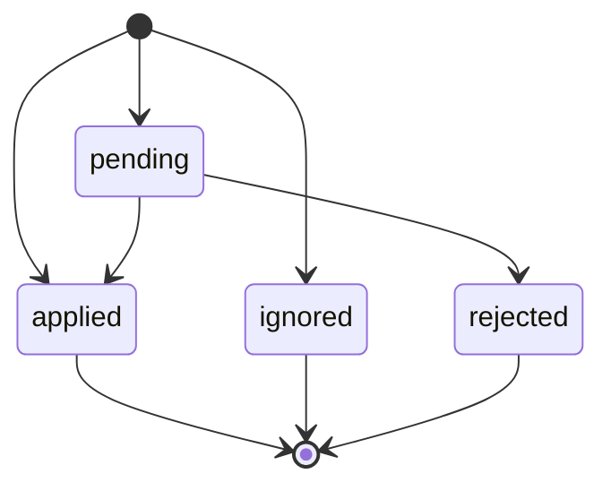
